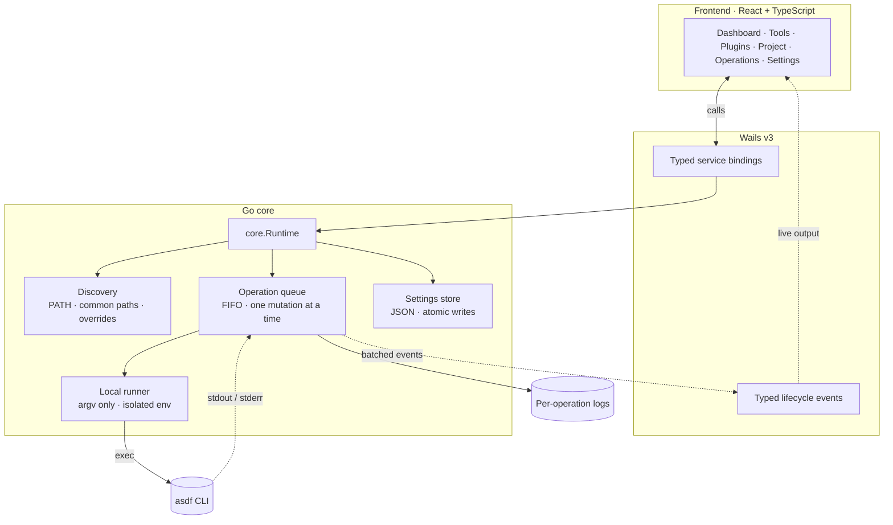
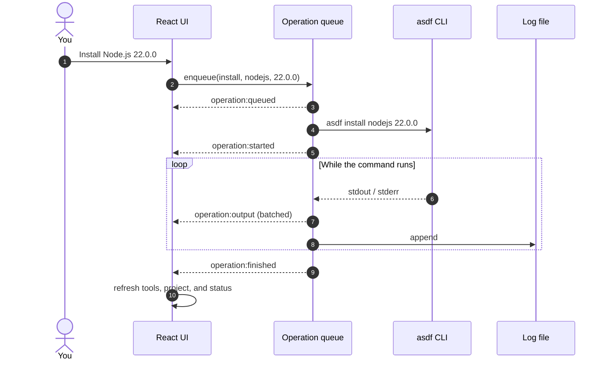

<div align="center">
  
</div>

<h1 align="center">asdf GUI</h1>

<p align="center">
  <strong>The version manager you already trust, with a face you can click.</strong><br/>
  A native desktop console for <a href="https://asdf-vm.com">asdf</a> — discover toolchains,<br/>
  pin project versions, and watch every operation stream by.
</p>

<p align="center">
  <a href="#install"><strong>Install</strong></a>
  &nbsp;·&nbsp;
  <a href="#quick-start"><strong>Quick start</strong></a>
  &nbsp;·&nbsp;
  <a href="#features"><strong>Features</strong></a>
  &nbsp;·&nbsp;
  <a href="#architecture"><strong>Architecture</strong></a>
  &nbsp;·&nbsp;
  <a href="#development"><strong>Development</strong></a>
  &nbsp;·&nbsp;
  <a href="#releases"><strong>Releases</strong></a>
  &nbsp;·&nbsp;
  <a href="#troubleshooting"><strong>Troubleshooting</strong></a>
</p>

<p align="center">
  <a href="https://wails.io"></a>
  
  
  
  
  
  
  
</p>

---

> **The short version.** asdf is excellent at what it does. Remembering the exact incantation for every plugin is less excellent. asdf GUI gives the version manager a proper desktop home: installed versions, missing versions, plugin management, project pinning, and live command output — without replacing the engine underneath.

> [!IMPORTANT]
> **MVP complete.** Every screen — dashboard, tools, plugins, project, operations, and settings — is wired to the real asdf CLI through typed Wails services. Linux AppImages are built automatically from version tags. Expect breaking changes before 1.0. macOS and Linux are supported. Native Windows is not supported in v1 — use the Linux build inside WSL2.

## Why another version manager UI?

Because asdf already works. This project is a **front-end, not a fork**.

- **The CLI stays in charge.** Every resolved version, every install, and every shim comes from your real `asdf` binary. There is no second resolution engine to drift out of sync.
- **No hidden state.** Project pins live in the `.tool-versions` file you already commit. Settings live in a small JSON file. Operation logs live on disk and are one click away.
- **Mutations are serialized.** asdf installs share a data directory, a plugin checkout, and a shim directory. asdf GUI runs write operations one at a time through a FIFO queue, so two installs can never race each other.
- **The work is visible.** Long installs stream stdout and stderr into the app line by line. Cancel stops the whole process group, not just the parent process.
- **It stays local.** No telemetry, no accounts, no background daemon, no bundled runtimes.

## Install

Grab the latest Linux AppImage from the
[releases page](https://github.com/AshutoshSajan/asdf-gui/releases):

```bash
chmod +x asdf-gui-*.AppImage
./asdf-gui-*.AppImage
```

The AppImage bundles the application and its GTK4/WebKitGTK 6.0 runtime
libraries. It still needs [asdf](https://asdf-vm.com/guide/getting-started.html)
on your `PATH` — the GUI drives your real CLI instead of shipping one.

<details>
<summary><strong>AppImage troubleshooting</strong></summary>

<br/>

AppImages need FUSE 2 to mount themselves. On distributions that only ship
FUSE 3, install `libfuse2` (Debian/Ubuntu) or `fuse2` (Arch), or run the
AppImage in extract mode:

```bash
./asdf-gui-*.AppImage --appimage-extract-and-run
```

The release binary is built on Ubuntu 24.04, so it requires glibc `2.39+`.
Older distributions should build from source against their own GTK stack.

</details>

## Quick start

### 1. Prerequisites

| Requirement | Version | Notes |
| :-- | :-- | :-- |
| [asdf](https://asdf-vm.com/guide/getting-started.html) | `0.20.x` tested | asdf GUI drives the CLI; it does not bundle it. |
| [Go](https://go.dev/dl/) | `1.26+` | Matches `go.mod`. |
| [Node.js](https://nodejs.org/) | `22+` | For Vite and the React frontend. |
| [Wails](https://wails.io) | `v3.1.0` | This project is pinned to Wails v3. |
| [Task](https://taskfile.dev) | `v3.54+` | Runs the project's build and packaging tasks. |

Install Wails and Task with Go:

```bash
go install github.com/wailsapp/wails/v3/cmd/wails3@v3.1.0
go install github.com/go-task/task/v3/cmd/task@v3.54.0
export PATH="$PATH:$(go env GOPATH)/bin"
```

On macOS, install the Xcode command line tools if you have not already:

```bash
xcode-select --install
```

<details>
<summary><strong>Linux system packages</strong></summary>

<br/>

Wails v3 uses the GTK4 + WebKitGTK 6.0 stack by default.

**Debian / Ubuntu**

```bash
sudo apt update
sudo apt install build-essential pkg-config libgtk-4-dev libwebkitgtk-6.0-dev
```

**Fedora**

```bash
sudo dnf install gcc pkgconf-pkg-config gtk4-devel webkitgtk6.0-devel
```

**Arch Linux**

```bash
sudo pacman -S base-devel pkgconf gtk4 webkitgtk-6.0
```

**GTK3 / WebKit2GTK 4.1 fallback**

Systems without WebKitGTK 6.0 can build with the `gtk3` tag after installing
`libgtk-3-dev libwebkit2gtk-4.1-dev` on Debian/Ubuntu:

```bash
task dev:gtk3
task build:gtk3
```

> Packaging metadata in `build/linux/nfpm/nfpm.yaml` targets GTK4, and the
> published AppImage is built against GTK4. Adjust the metadata if you ship GTK3
> packages.

</details>

### 2. Run it

```bash
git clone https://github.com/AshutoshSajan/asdf-gui.git
cd asdf-gui
task dev
```

The first run installs the frontend dependencies, generates the TypeScript
bindings from the Go services, and starts the Wails dev server with hot reload.

Install the dependency freshness hooks once per clone:

```bash
task hooks:install
```

### 3. Build a production binary

```bash
task build
# → bin/asdf-gui
```

Create installable artifacts with:

```bash
task package
```

Packaging definitions for AppImage, DEB, RPM, AUR, macOS app bundles, and DMG
files live under [`build/`](./build).

## Features

- **Dashboard** — engine status, plugin and version counts, the active project's
  pinned tools, missing versions, and recent operations in one view.
- **Tools** — browse every plugin and installed version, see which versions are
  currently resolved, load the full available version list for a plugin, and
  install, uninstall, or pin versions without typing a command.
- **Plugins** — inspect installed plugins with their repository URLs and refs,
  search the asdf plugin registry, add a plugin by name or URL, update one or
  all plugins, and remove plugins you no longer need.
- **Projects** — open a directory, read the nearest `.tool-versions` file,
  understand when a parent file is in effect, edit pinned versions, and install
  everything the project is missing. Comments, ordering, CRLF line endings, and
  file permissions survive edits.
- **Operations** — every mutation becomes an operation with a status, a live
  output stream, a cancel action, and a persisted log file. The queue shows what
  is running, what is waiting, and what failed.
- **Settings & diagnostics** — override the asdf binary or `ASDF_DATA_DIR`,
  choose a default project, follow the system theme or force dark/light, and run
  environment checks for bash, git, shims, and platform support.

### Designed around asdf's real behaviour

| Decision | Why |
| :-- | :-- |
| Parse CLI output instead of reimplementing resolution | Plugin scripts own version discovery. Guessing would be wrong. |
| Keep `.tool-versions` as the project source of truth | It is portable, reviewable, and already in your repository. |
| Serialize installs, uninstalls, sets, and plugin changes | These commands mutate shared asdf state. Concurrency is a bug factory. |
| Disable color and terminal interactivity for captured commands | `NO_COLOR=1`, `TERM=dumb`, and disabled git prompts make output predictable. |
| Stream output in batches | Keeps the UI responsive during large downloads without flooding the bridge. |
| Keep full logs on disk | The in-memory tail is capped; the log file is the durable record. |

## Architecture



### The operation lifecycle



Read-only commands (`list`, `current`, `latest`, `where`, `plugin list`) run
directly. Every command that can change shared state is queued. Queued operations
can be cancelled before they start; running operations are cancelled by killing
their process group and then reported as `canceled`.

## Security model

asdf GUI runs local commands on your behalf, so the boundaries are deliberate:

| Boundary | Design |
| :-- | :-- |
| **Shell injection** | Commands are executed as argv arrays with `exec.Command`. No shell is involved. |
| **Flag injection** | Tool, plugin, and version names starting with `-` are rejected before they reach asdf. |
| **Path handling** | Project directories are resolved and checked; `.tool-versions` edits stay inside the selected project. |
| **Concurrent writes** | Mutations run through a single FIFO queue. `.tool-versions` and settings are written atomically. |
| **Interactive prompts** | Git terminal prompts are disabled so plugin operations cannot hang waiting for credentials. |
| **External links** | Only `http://` and `https://` URLs are opened in the system browser. |
| **Privacy** | The app has no telemetry and makes no network calls of its own. Network activity comes from asdf and its plugins. |

Logs may contain local paths and command output. They stay on your machine.

## Data locations

| Data | Linux | macOS |
| :-- | :-- | :-- |
| Settings | `~/.config/asdf-gui/settings.json` | `~/Library/Application Support/asdf-gui/settings.json` |
| Operation logs | `~/.cache/asdf-gui/logs/` | `~/Library/Caches/asdf-gui/logs/` |
| asdf data | `~/.asdf` or `ASDF_DATA_DIR` | `~/.asdf` or `ASDF_DATA_DIR` |
| Project pins | `<project>/.tool-versions` | `<project>/.tool-versions` |
| Global pins | `~/.tool-versions` | `~/.tool-versions` |

Settings can point at a custom asdf binary or data directory. The app adds the
binary's directory to `PATH` and sets `ASDF_DATA_DIR` for every child command, so
the same installation is used for reads and writes.

## Platform support

| Platform | Status | Notes |
| :-- | :-- | :-- |
| **macOS** | Supported | Native Wails app. Packaging tasks produce `.app` and `.dmg` artifacts. |
| **Linux** | Supported | GTK4 + WebKitGTK 6.0 by default; `gtk3` build tag available for older stacks. Tagged releases ship an AppImage. |
| **Windows** | Not supported natively | v1 ships no Windows artifacts. Run the Linux build inside WSL2 (WSLg provides the display). |

The runner is deliberately behind a narrow interface, leaving room for a future
WSL bridge without changing the UI or the operation model.

## Development

```bash
task dev             # hot-reloading desktop app (GTK4)
task dev:gtk3        # hot-reloading desktop app (GTK3 / WebKit2GTK 4.1)
task build           # production binary in bin/
task build:gtk3      # production binary against GTK3
task package         # native packages (platform-dependent)
task linux:create:appimage   # → bin/asdf-gui-*.AppImage

task test            # backend tests + frontend type-check and build
task audit           # govulncheck + npm audit
task deps:check      # fails if direct Go/npm dependencies are outdated
task hooks:install   # install the repository git hooks
```

> Local Linux builds need `-tags gtk3` only when the GTK4/WebKitGTK 6.0 headers
> are unavailable. The `dev:gtk3` and `build:gtk3` tasks pass the tag for you.

Regenerate the TypeScript bindings after changing a Wails service signature:

```bash
wails3 generate bindings -ts -i
```

The generated files live in `frontend/bindings/` and are committed so a fresh
checkout can type-check before the first build. Do not edit them by hand.

### Quality gates

| Gate | What it runs | Where |
| :-- | :-- | :-- |
| **CI frontend** | `npm ci`, `tsc`, and a production Vite build | Every push and pull request |
| **CI backend** | `gofmt` check, `go vet`, race-enabled tests, and a desktop build | Every push and pull request |
| **CI audit** | `go mod verify`, `govulncheck`, and `npm audit --audit-level=high` | Every push and pull request |
| **pre-commit** | Dependency freshness check, only when a dependency manifest is staged | Local, warn-only |
| **pre-push** | Dependency freshness check for direct Go and npm dependencies | Local, blocking |

GitHub Actions are kept on their latest major versions, and Dependabot opens
grouped weekly updates for Actions, Go modules, and npm packages.

Install the hooks once per clone:

```bash
task hooks:install   # sets core.hooksPath to .githooks
task hooks:status    # shows whether the hooks are active
task hooks:uninstall # restores the default hooks directory
```

The pre-push gate blocks while a direct Go module or npm package is outdated.
Bypass it deliberately when offline with `SKIP_DEPS_CHECK=1 git push`. Indirect
updates are reported but do not block, and `task deps:check:warn` prints the
same report without failing.

### Project layout

```text
.
├── main.go                     # Wails entrypoint, service and event registration
├── internal/
│   ├── asdf/                   # detection, runner, parsers, .tool-versions editor
│   ├── core/                   # shared runtime, caching, runner factory
│   ├── ops/                    # FIFO queue, streamed events, cancellation, logs
│   ├── services/               # typed Wails services consumed by the UI
│   └── settings/               # JSON settings and recent projects
├── frontend/
│   ├── src/
│   │   ├── components/         # app shell, operation UI, Radix primitives
│   │   ├── screens/            # dashboard, tools, plugins, project, operations, settings
│   │   └── lib/                # bindings, query keys, routing, formatters
│   └── bindings/               # generated from Go — do not edit
├── build/                      # Wails build tasks, packaging, platform assets
├── .github/workflows/          # CI, audit, and release automation
├── .githooks/                  # dependency freshness gates
├── scripts/                    # dependency check helper
├── docs/assets/                # README artwork
└── Taskfile.yml                # developer entrypoints
```

## Releases

Releases are driven by tags. The [release workflow](./.github/workflows/release.yml)
builds the AppImage on Ubuntu 24.04 against GTK4/WebKitGTK 6.0:

1. Bump `build/config.yml` and `frontend/package.json`, then commit.
2. Tag and push:

   ```bash
   git tag v0.2.0
   git push origin v0.2.0
   ```

The workflow syncs the tag version into the build metadata, runs
`task linux:create:appimage`, unpacks the result to verify `AppRun` and the
desktop entry, uploads the artifact, and publishes a GitHub release with the
AppImage attached.

## Troubleshooting

<details>
<summary><strong>asdf was not found</strong></summary>

<br/>

Check that the CLI works in a terminal:

```bash
asdf --version
which asdf
```

asdf GUI searches `PATH`, `~/.asdf/bin`, `~/.local/bin`, Homebrew locations, and
`/usr/local/bin`. If your installation lives elsewhere, open **Settings → asdf
binary** and select it, or set the path in `settings.json`.

</details>

<details>
<summary><strong>Package gtk4 was not found</strong></summary>

<br/>

The default Wails v3 backend needs GTK4 and WebKitGTK 6.0 development headers.
Install the packages listed in [Quick start](#quick-start), or build against the
legacy stack with:

```bash
task dev:gtk3
```

</details>

<details>
<summary><strong>A plugin command hangs or fails at a credential prompt</strong></summary>

<br/>

asdf GUI runs commands with `GIT_TERMINAL_PROMPT=0` and `GIT_ASKPASS=true` so a
missing credential fails instead of waiting forever. Configure credential
helpers, SSH keys, or tokens in your normal Git environment before installing
private plugins.

</details>

<details>
<summary><strong>Versions are missing from the project</strong></summary>

<br/>

Open the project screen and choose **Install missing**, or run the install from
the tools screen. The project view compares `.tool-versions` entries with
`asdf current`; an entry can be pinned but not installed yet.

</details>

<details>
<summary><strong>Running on Windows</strong></summary>

<br/>

Native Windows is not supported in v1. Install WSL2 with a Linux distribution,
install the Linux prerequisites inside WSL, and run the Linux build there.
Windows 11's WSLg provides the display and audio integration.

</details>

## Non-goals

- Replacing asdf's version resolution with a second implementation.
- Bundling language runtimes or hiding plugin scripts.
- Shipping native Windows artifacts in v1.
- Sending usage data or requiring an account.

## Roadmap

- [x] asdf discovery and validation with manual overrides
- [x] Serialized operation queue with streamed output, cancellation, and log files
- [x] Comment-preserving `.tool-versions` editing with atomic writes
- [x] Typed Wails services and generated TypeScript bindings
- [x] Dark-first app shell, dashboard, and shared UI primitives
- [x] Tools, plugins, project, operations, and settings screens
- [x] CI for tests, builds, vulnerability scans, and dependency audits
- [x] Tag-driven Linux AppImage releases
- [ ] Signed release artifacts for macOS and Linux
- [ ] WSL2 runner bridge
- [ ] Multi-project workspaces and richer version comparisons

## Contributing

Contributions are welcome. Before opening a pull request:

1. Keep asdf as the source of truth — do not reimplement version resolution.
2. Run `task test` (backend tests plus a frontend type-check/build) and
   `task audit`.
3. Install the hooks with `task hooks:install` so dependency freshness is
   checked before you push.
4. Regenerate bindings if you changed a service signature.
5. Keep user-facing changes consistent with the existing dark-first design and
   the security boundaries above.

For larger changes, open an issue first so the approach can be discussed.

## License

MIT © [Ashutosh Sajan](https://github.com/AshutoshSajan). See [`LICENSE`](./LICENSE).

---

<p align="center">
  <sub>asdf GUI is an independent project. It is not affiliated with the asdf maintainers.</sub><br/>
  <sub>Built with Go, <a href="https://wails.io">Wails v3</a>, React, and a healthy respect for the command line.</sub>
</p>
