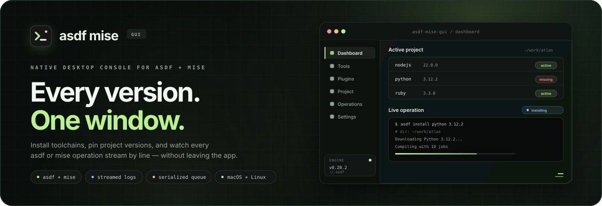
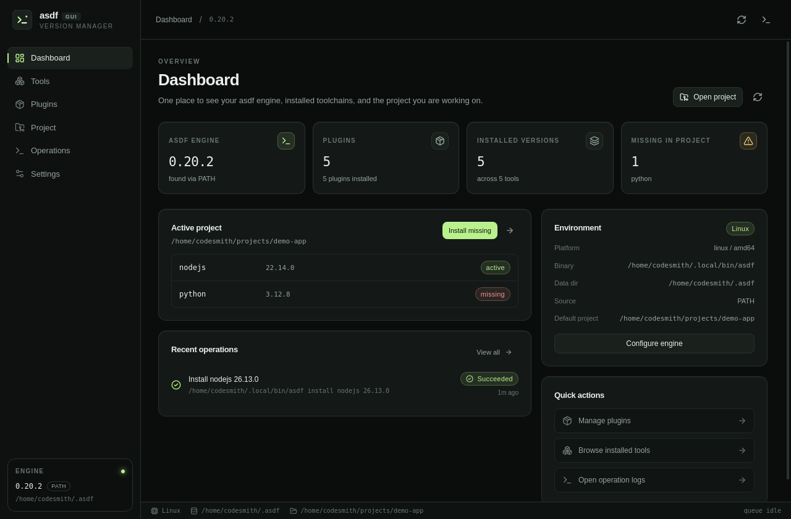
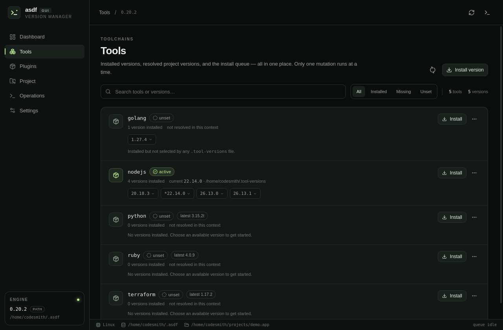
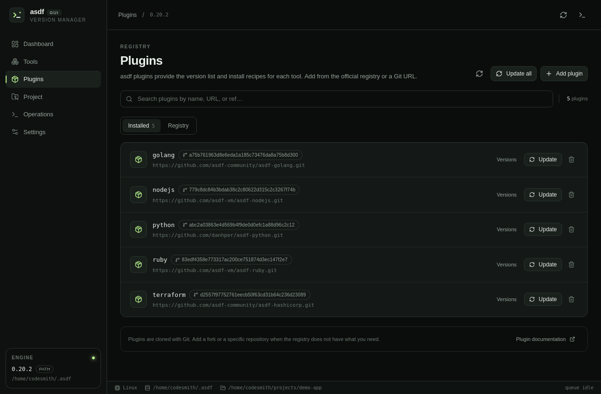
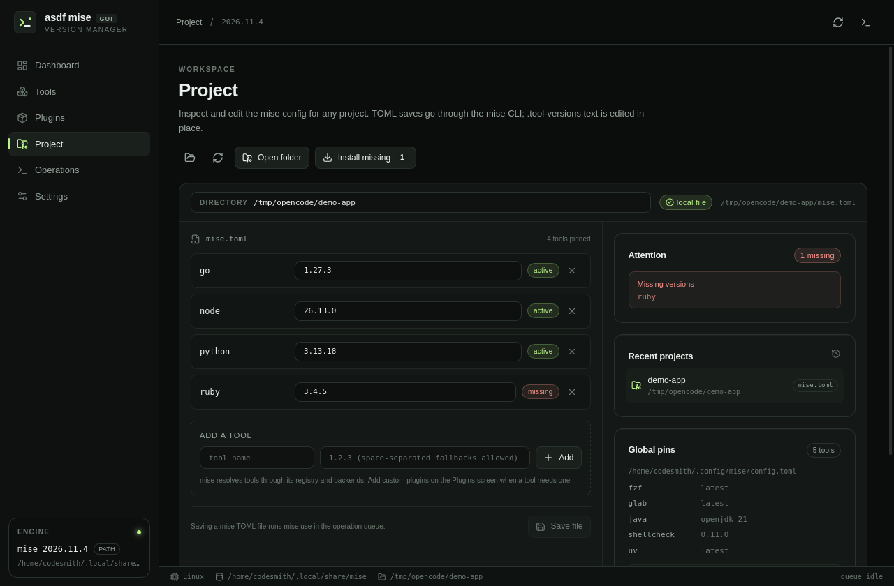
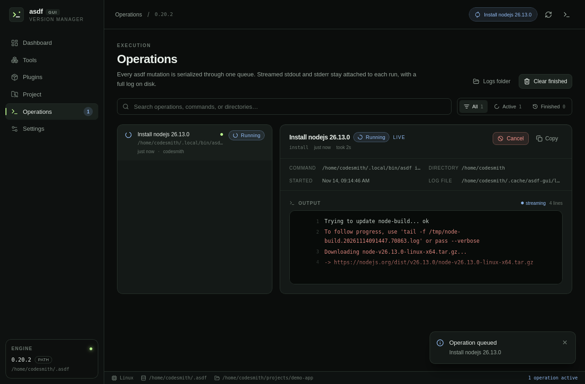
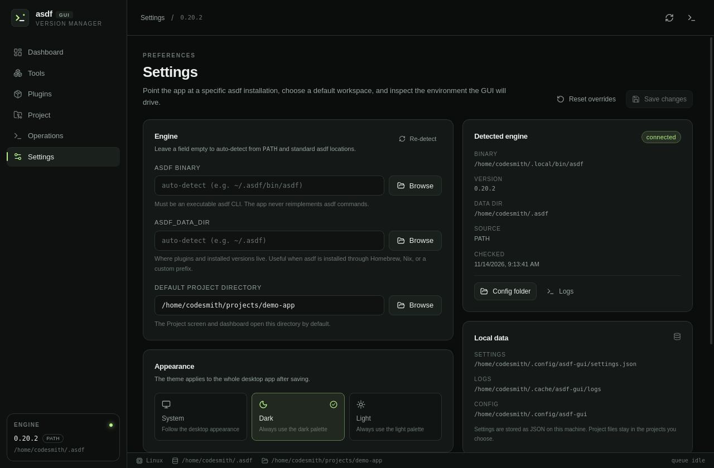
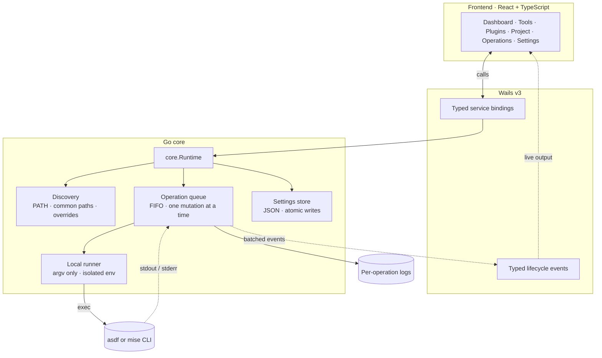
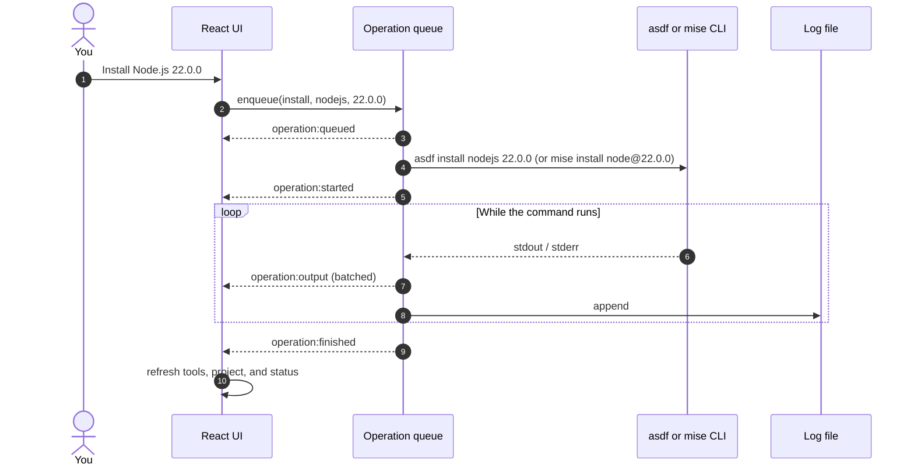

<div align="center">
  
</div>

<h1 align="center">asdf mise GUI</h1>

<p align="center">
  <strong>The version managers you already trust, with a face you can click.</strong><br/>
  A native desktop console for <a href="https://asdf-vm.com">asdf</a> and
  <a href="https://mise.jdx.dev/">mise</a> — discover toolchains,<br/>
  pin project versions, and watch every operation stream by.
</p>

<p align="center">
  <a href="#install"><strong>Install</strong></a>
  &nbsp;·&nbsp;
  <a href="#quick-start"><strong>Quick start</strong></a>
  &nbsp;·&nbsp;
  <a href="#features"><strong>Features</strong></a>
  &nbsp;·&nbsp;
  <a href="#screenshots"><strong>Screenshots</strong></a>
  &nbsp;·&nbsp;
  <a href="#architecture"><strong>Architecture</strong></a>
  &nbsp;·&nbsp;
  <a href="#development"><strong>Development</strong></a>
  &nbsp;·&nbsp;
  <a href="#releases"><strong>Releases</strong></a>
  &nbsp;·&nbsp;
  <a href="#troubleshooting"><strong>Troubleshooting</strong></a>
</p>

<p align="center">
  <a href="https://wails.io"></a>
  
  
  
  
  
  
  
</p>

---

> **The short version.** asdf and mise are excellent at what they do. Remembering the exact incantation for every plugin is less excellent. asdf mise GUI gives both version managers a proper desktop home: installed versions, missing versions, plugin management, project pinning, and live command output — without replacing the engine underneath.

> [!IMPORTANT]
> **MVP complete.** Every screen — dashboard, tools, plugins, project, operations, and settings — is wired to the real asdf or mise CLI through typed Wails services. Tagged releases build an AppImage, DEB/RPM/Arch packages, a universal macOS DMG, and a Windows installer. Expect breaking changes before 1.0.

## Screenshots

Every screen below is a real capture of the running app driving mise. Click an
image to open the full-size shot. The same screens drive asdf when it is
selected as the engine.

<table>
  <tr>
    <td width="50%" valign="top">
      <a href="./docs/assets/screenshots/dashboard.png"></a>
      <br/>
      <sub><strong>Dashboard</strong> — engine health, toolchain counts, and project state at a glance.</sub>
    </td>
    <td width="50%" valign="top">
      <a href="./docs/assets/screenshots/tools.png"></a>
      <br/>
      <sub><strong>Tools</strong> — installed versions, resolved pins, latest releases, and one-click installs.</sub>
    </td>
  </tr>
  <tr>
    <td width="50%" valign="top">
      <a href="./docs/assets/screenshots/plugins.png"></a>
      <br/>
      <sub><strong>Plugins</strong> — browse the entire asdf or mise registry in one searchable list.</sub>
    </td>
    <td width="50%" valign="top">
      <a href="./docs/assets/screenshots/project.png"></a>
      <br/>
      <sub><strong>Project</strong> — edit <code>.tool-versions</code> or <code>mise.toml</code> and install missing pins.</sub>
    </td>
  </tr>
  <tr>
    <td width="50%" valign="top">
      <a href="./docs/assets/screenshots/operations.png"></a>
      <br/>
      <sub><strong>Operations</strong> — one serialized queue, live output, and a persisted log for every run.</sub>
    </td>
    <td width="50%" valign="top">
      <a href="./docs/assets/screenshots/settings.png"></a>
      <br/>
      <sub><strong>Settings</strong> — detect asdf or mise, choose a workspace, pick a theme, and run diagnostics.</sub>
    </td>
  </tr>
</table>

## Why another version manager UI?

Because asdf and mise already work. This project is a **front-end, not a fork**.

- **The CLI stays in charge.** Every resolved version, every install, and every shim comes from your real `asdf` or `mise` binary. There is no second resolution engine to drift out of sync.
- **No hidden state.** Project pins live in the `.tool-versions` or `mise.toml` file you already commit. Settings live in a small JSON file. Operation logs live on disk and are one click away.
- **Mutations are serialized.** Version managers share a data directory, a plugin checkout, and a shim directory. asdf mise GUI runs write operations one at a time through a FIFO queue, so two installs can never race each other.
- **The work is visible.** Long installs stream stdout and stderr into the app line by line. Cancel stops the whole process group, not just the parent process.
- **It stays local.** No telemetry, no accounts, no background daemon, no bundled runtimes. The only network call the app makes itself is an optional GitHub release check.

## Install

Every tagged release publishes native builds for Linux, macOS, and Windows on
the [releases page](https://github.com/AshutoshSajan/asdf-mise-gui/releases).

### Linux

Choose the package that fits your distribution:

```bash
# AppImage — self-updating, bundles GTK4/WebKitGTK 6.0
chmod +x asdf-mise-gui-linux-x86_64.AppImage
./asdf-mise-gui-linux-x86_64.AppImage

# Debian / Ubuntu
sudo apt install ./asdf-mise-gui-linux-amd64.deb

# Fedora / RHEL / AlmaLinux / Rocky
sudo dnf install ./asdf-mise-gui-linux-x86_64.rpm

# Arch Linux
sudo pacman -U ./asdf-mise-gui-linux-x86_64.pkg.tar.zst
```

The DEB, RPM, and Arch packages depend on the distribution's GTK4 + WebKitGTK
6.0 packages. Each release publishes a `checksums.txt` with SHA-256 digests for
every asset.

### macOS

Download `asdf-mise-gui-darwin-universal.dmg`, open it, and drag
**asdf-mise-gui** into Applications. Official releases are Developer ID signed
and notarized when the repository signing credentials are configured; unsigned
or community builds are ad-hoc signed and Gatekeeper warns on first launch. In
that case, right-click the app and choose **Open**, or clear the quarantine
flag:

```bash
xattr -dr com.apple.quarantine "/Applications/asdf-mise-gui.app"
```

### Windows

Download `asdf-mise-gui-windows-amd64-installer.exe` and run it. The installer
bundles the WebView2 bootstrapper. A portable
`asdf-mise-gui-windows-amd64.exe` is published alongside it. Both are
Authenticode signed when the repository certificate secrets are configured;
unsigned or community builds may trigger SmartScreen on first launch.

[mise](https://mise.jdx.dev/getting-started.html) is the recommended engine on
native Windows. asdf itself is a Unix shell tool; asdf users should run the
Linux AppImage inside WSL2, where WSLg provides the display.

All builds still need the real asdf or mise CLI on `PATH` — the GUI drives your
CLI instead of shipping one.

<details>
<summary><strong>AppImage troubleshooting</strong></summary>

<br/>

AppImages need FUSE 2 to mount themselves. On distributions that only ship
FUSE 3, install `libfuse2` (Debian/Ubuntu) or `fuse2` (Arch), or run the
AppImage in extract mode:

```bash
./asdf-mise-gui-*.AppImage --appimage-extract-and-run
```

The release binary is built on Ubuntu 24.04, so it requires glibc `2.39+`.
Older distributions should build from source against their own GTK stack.

</details>

## Updates

AppImage builds update themselves. The app checks
[GitHub Releases](https://github.com/AshutoshSajan/asdf-mise-gui/releases) once
at launch and whenever you choose **Settings → Updates → Check now**. When a
newer release exists, a banner shows the version and its release notes. Nothing
is downloaded until you choose **Update now**.

On the AppImage build, the download is streamed to a staging file, verified
against the release's `checksums.txt` (SHA-256), swapped into place, and the app
restarts. A missing or mismatched checksum aborts the install and leaves the
current AppImage untouched. Settings, projects, and asdf/mise data are not
modified.

macOS, Windows, and Linux packages other than the AppImage cannot replace
themselves. They show the same update notice but open the GitHub release page
instead. macOS builds are ad-hoc signed and the Windows installer is unsigned,
so the operating system may warn on first launch.

Launch checks are enabled by default and can be disabled in
**Settings → Updates**; manual checks always work. The app's only outbound
request of its own is this GitHub API check. It sends no account information,
usage data, or local paths. asdf and mise plugin traffic remains between those
CLIs and their upstreams.

## Quick start

### 1. Prerequisites

| Requirement | Version | Notes |
| :-- | :-- | :-- |
| [asdf](https://asdf-vm.com/guide/getting-started.html) or [mise](https://mise.jdx.dev/getting-started.html) | asdf `0.20.x`, mise `2026.x` tested | The GUI drives the selected engine; it does not bundle one. |
| [Go](https://go.dev/dl/) | `1.27.4+` | Matches `go.mod`. |
| [Node.js](https://nodejs.org/) | `22+` | For Vite and the React frontend. |
| [Wails](https://wails.io) | `v3.1.0` | This project is pinned to Wails v3. |
| [Task](https://taskfile.dev) | `v3.54+` | Runs the project's build and packaging tasks. |

Install Wails and Task with Go:

```bash
go install github.com/wailsapp/wails/v3/cmd/wails3@v3.1.0
go install github.com/go-task/task/v3/cmd/task@v3.54.0
export PATH="$PATH:$(go env GOPATH)/bin"
```

On macOS, install the Xcode command line tools if you have not already:

```bash
xcode-select --install
```

<details>
<summary><strong>Linux system packages</strong></summary>

<br/>

Wails v3 uses the GTK4 + WebKitGTK 6.0 stack by default.

**Debian / Ubuntu**

```bash
sudo apt update
sudo apt install build-essential pkg-config libgtk-4-dev libwebkitgtk-6.0-dev
```

**Fedora**

```bash
sudo dnf install gcc pkgconf-pkg-config gtk4-devel webkitgtk6.0-devel
```

**Arch Linux**

```bash
sudo pacman -S base-devel pkgconf gtk4 webkitgtk-6.0
```

**GTK3 / WebKit2GTK 4.1 fallback**

Systems without WebKitGTK 6.0 can build with the `gtk3` tag after installing
`libgtk-3-dev libwebkit2gtk-4.1-dev` on Debian/Ubuntu:

```bash
task dev:gtk3
task build:gtk3
```

> Packaging metadata in `build/linux/nfpm/nfpm.yaml` targets GTK4, and the
> published AppImage is built against GTK4. Adjust the metadata if you ship GTK3
> packages.

</details>

### 2. Run it

```bash
git clone https://github.com/AshutoshSajan/asdf-mise-gui.git
cd asdf-mise-gui
task dev
```

If the build stops with `Package 'gtk4' ... not found` or
`Package 'webkitgtk-6.0' ... not found`, run `task dev:gtk3` instead. It uses
the GTK3/WebKit2GTK 4.1 backend already available on that machine — the rest of
the app is identical.

The first run installs the frontend dependencies, generates the TypeScript
bindings from the Go services, and starts the Wails dev server with hot reload.

Install the dependency freshness hooks once per clone:

```bash
task hooks:install
```

### 3. Build a production binary

```bash
task build
# → bin/asdf-mise-gui
```

Create installable artifacts with:

```bash
task package
```

Packaging definitions for AppImage, DEB, RPM, AUR, macOS app bundles, and DMG
files live under [`build/`](./build).

## Features

- **Dashboard** — engine status, plugin and version counts, the active project's
  pinned tools, missing versions, and recent operations in one view.
- **Tools** — browse every tool and installed version, see which versions are
  currently resolved, load the full available version list, and install,
  uninstall, or pin versions without typing a command.
- **Plugins** — inspect installed plugins with their repository URLs and refs,
  search the asdf or mise registry, add a plugin by name or URL, update one or
  all plugins, and remove plugins you no longer need.
- **Projects** — open a directory, read the nearest `.tool-versions` or mise
  config file, understand when a parent file is in effect, edit pinned versions,
  and install everything the project is missing. asdf edits preserve comments,
  ordering, CRLF line endings, and file permissions; mise TOML saves go through
  `mise use` so the real parser stays authoritative.
- **Operations** — every mutation becomes an operation with a status, a live
  output stream, a cancel action, and a persisted log file. The queue shows what
  is running, what is waiting, and what failed.
- **Updates** — check GitHub Releases at launch or on demand, read release notes,
  and let the AppImage verify a SHA-256 checksum and restart into the new build.
  Other builds link to the release download page.
- **Settings & diagnostics** — choose asdf or mise (or auto-detect), override
  the binary or `ASDF_DATA_DIR`/`MISE_DATA_DIR`, choose a default project, follow
  the system theme or force dark/light, control launch update checks, and run
  environment checks for bash, git, shims, and platform support.

### Designed around real engine behaviour

| Decision | Why |
| :-- | :-- |
| Parse CLI output and mise JSON instead of reimplementing resolution | Plugin scripts and mise own version discovery. Guessing would be wrong. |
| Keep `.tool-versions` and `mise.toml` as the project source of truth | They are portable, reviewable, and already in your repository. |
| Serialize installs, uninstalls, sets, and plugin changes | These commands mutate shared engine state. Concurrency is a bug factory. |
| Disable color and terminal interactivity for captured commands | `NO_COLOR=1`, `TERM=dumb`, and disabled git prompts make output predictable. |
| Stream output in batches | Keeps the UI responsive during large downloads without flooding the bridge. |
| Keep full logs on disk | The in-memory tail is capped; the log file is the durable record. |

## Architecture



### The operation lifecycle



Read-only commands (`list`, `current`, `latest`, `where`, `plugin list`, and
their mise JSON equivalents) run directly. Every command that can change shared
state is queued. Queued operations
can be cancelled before they start; running operations are cancelled by killing
their process group and then reported as `canceled`.

## Security model

asdf mise GUI runs local commands on your behalf, so the boundaries are deliberate:

| Boundary | Design |
| :-- | :-- |
| **Shell injection** | Commands are executed as argv arrays with `exec.Command`. No shell is involved. |
| **Flag injection** | Tool, plugin, and version names starting with `-` are rejected before they reach the engine. |
| **Path handling** | Project directories are resolved and checked; `.tool-versions` edits stay inside the selected project, and mise writes target that project's config. |
| **Concurrent writes** | Mutations run through a single FIFO queue. `.tool-versions` and settings are written atomically; mise TOML writes go through `mise use`. |
| **Interactive prompts** | Git terminal prompts are disabled so plugin operations cannot hang waiting for credentials. |
| **External links** | Only `http://` and `https://` URLs are opened in the system browser. |
| **Update verification** | Every release publishes SHA-256 digests for all assets in `checksums.txt`. AppImage self-update aborts unless the download matches its entry. |
| **Privacy** | The app has no telemetry. Its only own network call is the optional GitHub Releases update check; all other network activity comes from asdf, mise, and their plugins. |

Logs may contain local paths and command output. They stay on your machine.

## Data locations

| Data | Linux | macOS |
| :-- | :-- | :-- |
| Settings | `~/.config/asdf-mise-gui/settings.json` | `~/Library/Application Support/asdf-mise-gui/settings.json` |
| Operation logs | `~/.cache/asdf-mise-gui/logs/` | `~/Library/Caches/asdf-mise-gui/logs/` |
| asdf data | `~/.asdf` or `ASDF_DATA_DIR` | `~/.asdf` or `ASDF_DATA_DIR` |
| mise data | `~/.local/share/mise` or `MISE_DATA_DIR` | `~/Library/Application Support/mise` or `MISE_DATA_DIR` |
| asdf project pins | `<project>/.tool-versions` | `<project>/.tool-versions` |
| mise project config | `<project>/mise.toml` or `.tool-versions` | `<project>/mise.toml` or `.tool-versions` |
| asdf global pins | `~/.tool-versions` | `~/.tool-versions` |
| mise global config | `~/.config/mise/config.toml` | `~/.config/mise/config.toml` |

Settings can point at a custom asdf or mise binary and data directory. The app
adds the binary's directory to `PATH` and sets `ASDF_DATA_DIR` or `MISE_DATA_DIR`
for every child command, so the same installation is used for reads and writes.
Existing `asdf-gui` settings are imported once into the new location.

## Platform support

| Platform | Status | Notes |
| :-- | :-- | :-- |
| **macOS** | Supported | Native Wails app. Releases ship a universal `.dmg` (arm64 + amd64). Ad-hoc signed, not notarized. |
| **Linux** | Supported | GTK4 + WebKitGTK 6.0 by default; `gtk3` build tag available for older stacks. Releases ship AppImage, DEB, RPM, and Arch packages. |
| **Windows** | Supported | Native Wails app with WebView2. Releases ship an NSIS installer and a portable `.exe`. mise is recommended; asdf users should use WSL2. |

The runner is deliberately behind a narrow interface, leaving room for a future
WSL bridge without changing the UI or the operation model.

## Development

```bash
task dev             # hot-reloading desktop app (GTK4)
task dev:gtk3        # hot-reloading desktop app (GTK3 / WebKit2GTK 4.1)
task build           # production binary in bin/
task build:gtk3      # production binary against GTK3
task package         # native packages (platform-dependent)
task linux:package   # AppImage + DEB + RPM + Arch packages
task linux:create:appimage   # → bin/asdf-mise-gui-*.AppImage
task darwin:package:dmg:universal  # universal macOS DMG (macOS host)
task windows:package         # NSIS installer and portable EXE (Windows host)

task test            # backend tests + frontend type-check and build
task audit           # govulncheck + npm audit
task deps:check      # fails if direct Go/npm dependencies are outdated
task hooks:install   # install the repository git hooks
```

> Local Linux builds need `-tags gtk3` only when the GTK4/WebKitGTK 6.0 headers
> are unavailable. The `dev:gtk3` and `build:gtk3` tasks pass the tag for you.
> `wails3` bundles Task, so if `task` is not on your `PATH`, use
> `wails3 task dev:gtk3` (or prefix any other task the same way).

Regenerate the TypeScript bindings after changing a Wails service signature:

```bash
wails3 generate bindings -ts -i
```

The generated files live in `frontend/bindings/` and are committed so a fresh
checkout can type-check before the first build. Do not edit them by hand.

### Quality gates

| Gate | What it runs | Where |
| :-- | :-- | :-- |
| **CI frontend** | `npm ci`, `tsc`, and a production Vite build | Every push and pull request |
| **CI backend** | `gofmt` check, `go vet`, race-enabled tests, and a desktop build | Every push and pull request |
| **CI audit** | `go mod verify`, `govulncheck`, and `npm audit --audit-level=high` | Every push and pull request |
| **pre-commit** | Dependency freshness check, only when a dependency manifest is staged | Local, warn-only |
| **pre-push** | Dependency freshness check for direct Go and npm dependencies | Local, blocking |

GitHub Actions are kept on their latest major versions, and Dependabot opens
grouped weekly updates for Actions, Go modules, and npm packages.

Install the hooks once per clone:

```bash
task hooks:install   # sets core.hooksPath to .githooks
task hooks:status    # shows whether the hooks are active
task hooks:uninstall # restores the default hooks directory
```

The pre-push gate blocks while a direct Go module or npm package is outdated.
Bypass it deliberately when offline with `SKIP_DEPS_CHECK=1 git push`. Indirect
updates are reported but do not block, and `task deps:check:warn` prints the
same report without failing.

### Project layout

```text
.
├── main.go                     # Wails entrypoint, service and event registration
├── internal/
│   ├── asdf/                   # asdf/mise detection, runner, parsers, config editors
│   ├── core/                   # shared runtime, caching, runner factory
│   ├── ops/                    # FIFO queue, streamed events, cancellation, logs
│   ├── services/               # typed Wails services consumed by the UI
│   ├── settings/               # JSON settings and recent projects
│   └── version/                # single source of truth for the app version
├── frontend/
│   ├── src/
│   │   ├── components/         # app shell, operation UI, Radix primitives
│   │   ├── screens/            # dashboard, tools, plugins, project, operations, settings
│   │   └── lib/                # bindings, query keys, routing, formatters
│   └── bindings/               # generated from Go — do not edit
├── build/                      # Wails build tasks, packaging, platform assets
├── .github/workflows/          # CI, audit, and release automation
├── .githooks/                  # dependency freshness gates
├── scripts/                    # dependency check helper and version sync
├── docs/assets/                # README banner and app screenshots
└── Taskfile.yml                # developer entrypoints
```

## Releases

Releases are driven by tags. The [release workflow](./.github/workflows/release.yml)
builds every platform in parallel, then publishes one release:

| Job | Runner | Assets |
| :-- | :-- | :-- |
| Linux | Ubuntu 24.04 | AppImage, DEB, RPM, Arch package |
| macOS | macOS | Universal DMG (arm64 + amd64) |
| Windows | Windows | NSIS installer and portable EXE |

Pull requests that touch the release pipeline build all three platforms without
publishing, so packaging regressions fail before a tag is cut.

macOS and Windows artifacts are signed and notarized when the repository
signing secrets are present. See [Release signing](docs/release-signing.md) for
the secrets, export steps, and verification commands. Without them, the workflow
publishes the ad-hoc signed macOS DMG and unsigned Windows binaries.

1. Bump every versioned file with the repository script, then commit:

   ```bash
   node scripts/set-version.mjs 0.3.0
   ```

2. Tag and push:

   ```bash
   git tag v0.3.0
   git push origin v0.3.0
   ```

The workflow syncs the tag version into the build metadata with the same script,
builds all three platforms, verifies the AppImage, and normalizes asset names.
A final job writes `checksums.txt` with `sha256sum` and publishes every package
in one GitHub release.

The updater resolves the AppImage by `asdf-mise-gui-linux-<arch>.AppImage`. Keep
that pattern when changing packaging, or AppImage self-update will stop finding
new releases. Only the AppImage self-updates; the other assets are manual
downloads.

## Troubleshooting

<details>
<summary><strong>asdf or mise was not found</strong></summary>

<br/>

Check that the selected CLI works in a terminal:

```bash
asdf --version
which asdf
mise --version
which mise
```

asdf mise GUI searches `PATH`, `~/.asdf/bin`, `~/.local/bin`, `~/.local/share/mise`,
Homebrew locations, and `/usr/local/bin`. If your installation lives elsewhere,
open **Settings → Engine**, choose the engine, and select its binary, or set the
path in `settings.json`.

</details>

<details>
<summary><strong>Package gtk4 was not found</strong></summary>

<br/>

The default Wails v3 backend needs GTK4 and WebKitGTK 6.0 development headers.
Install the packages listed in [Quick start](#quick-start), or build against the
legacy stack with:

```bash
task dev:gtk3
```

</details>

<details>
<summary><strong>A plugin command hangs or fails at a credential prompt</strong></summary>

<br/>

asdf mise GUI runs commands with `GIT_TERMINAL_PROMPT=0` and `GIT_ASKPASS=true` so a
missing credential fails instead of waiting forever. Configure credential
helpers, SSH keys, or tokens in your normal Git environment before installing
private plugins.

</details>

<details>
<summary><strong>Versions are missing from the project</strong></summary>

<br/>

Open the project screen and choose **Install missing**, or run the install from
the tools screen. The project view compares config entries with the engine's
current resolution; an entry can be pinned but not installed yet.

</details>

<details>
<summary><strong>mise refuses to read a project config</strong></summary>

<br/>

mise only loads config files it trusts. If the project screen reports
`Config files ... are not trusted`, review the file and trust it once from a
terminal:

```bash
cd /path/to/project
mise trust
```

Trust is mise's security boundary, so asdf mise GUI does not bypass it.

</details>

<details>
<summary><strong>Running on Windows</strong></summary>

<br/>

Native Windows builds are published from every tag. They use WebView2 (the
NSIS installer bootstraps it) and work best with mise. asdf is a Unix shell
tool, so if your toolchains depend on asdf, install WSL2 and run the Linux
AppImage inside WSL. Windows 11's WSLg provides the display and audio
integration.

</details>

## Non-goals

- Replacing asdf or mise version resolution with a second implementation.
- Bundling language runtimes or hiding plugin scripts.
- Sending usage data or requiring an account.

## Roadmap

- [x] asdf discovery and validation with manual overrides
- [x] mise discovery, JSON parsing, config editing, and `mise use` pinning
- [x] Auto/asdf/mise engine selection with per-engine settings
- [x] Serialized operation queue with streamed output, cancellation, and log files
- [x] Comment-preserving `.tool-versions` editing with atomic writes
- [x] Typed Wails services and generated TypeScript bindings
- [x] Theme-aware app shell, dashboard, and shared UI primitives
- [x] Tools, plugins, project, operations, and settings screens
- [x] CI for tests, builds, vulnerability scans, and dependency audits
- [x] Tag-driven Linux AppImage releases
- [x] macOS DMG and Windows installer releases
- [x] In-app update checks with verified AppImage self-update
- [x] Signed and notarized macOS and Windows artifacts
- [ ] WSL2 runner bridge
- [ ] Multi-project workspaces and richer version comparisons

## Contributing

Contributions are welcome. Before opening a pull request:

1. Branch from `dev` and target `dev`; changes reach `master` through a
   separate `dev` → `master` promotion pull request.
2. Keep the selected engine as the source of truth — do not reimplement version resolution.
3. Run `task test` (backend tests plus a frontend type-check/build) and
   `task audit`.
4. Install the hooks with `task hooks:install` so dependency freshness is
   checked before you push.
5. Regenerate bindings if you changed a service signature.
6. Keep user-facing changes consistent with the existing dark-first design and
   the security boundaries above.

For larger changes, open an issue first so the approach can be discussed.

## License

MIT © [Ashutosh Sajan](https://github.com/AshutoshSajan). See [`LICENSE`](./LICENSE).

---

<p align="center">
  <sub>asdf mise GUI is an independent project. It is not affiliated with the asdf or mise maintainers.</sub><br/>
  <sub>Built with Go, <a href="https://wails.io">Wails v3</a>, React, and a healthy respect for the command line.</sub>
</p>
